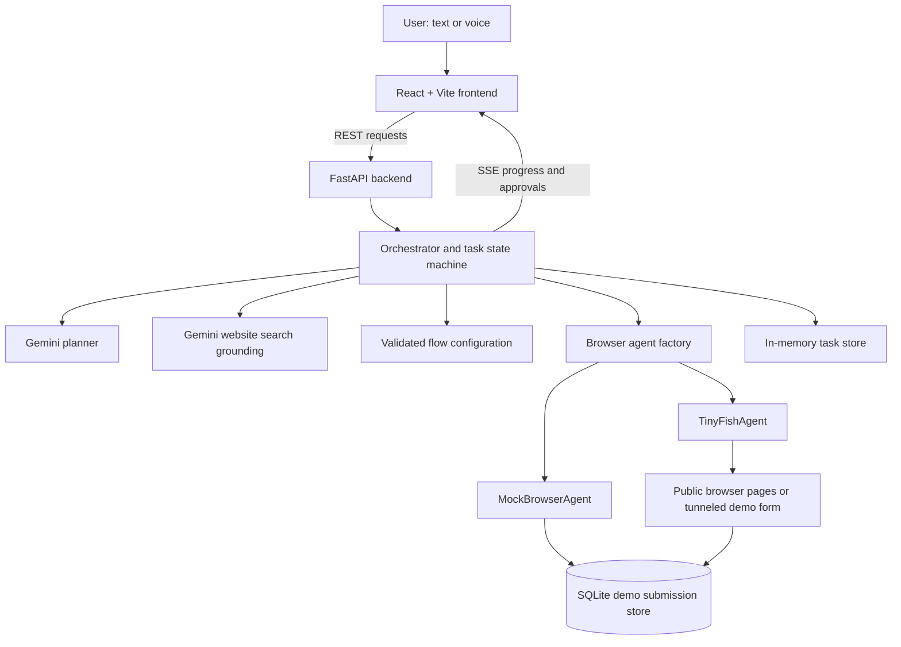

# SahayakAI

**A bilingual, voice-enabled web assistant for public-information discovery and guided form completion.**

SahayakAI helps people interact with supported public websites in Hindi or English. The user describes a task in natural language, the planner converts that request into structured data, and the backend coordinates the next steps. Users can review details before browser actions and must explicitly approve the demo form submission. The system streams progress and reports success only when the required evidence is available.

> **Project status:** Hackathon prototype. The repository includes a mock browser agent for deterministic development and testing, plus an optional TinyFish integration for live browser automation. It is not a production government-services portal.

Repository: [GrowlingBear01/SahayakAI](https://github.com/GrowlingBear01/SahayakAI)

## Contents

- [What it does](#what-it-does)
- [Workflows](#workflows)
- [Key design principles](#key-design-principles)
- [Architecture](#architecture)
- [Tech stack](#tech-stack)
- [Repository layout](#repository-layout)
- [Prerequisites](#prerequisites)
- [Configuration](#configuration)
- [Run locally](#run-locally)
- [API reference](#api-reference)
- [Task lifecycle](#task-lifecycle)
- [Testing](#testing)
- [M10 recorded results](#m10-recorded-results)
- [Safety and privacy](#safety-and-privacy)
- [Current limitations](#current-limitations)
- [Troubleshooting](#troubleshooting)

## What it does

- Accepts typed requests and supports browser-based speech recognition and text-to-speech in Hindi and English.
- Uses a Gemini planner to interpret a request and return structured JSON for a supported workflow.
- Validates extracted values against the selected flow's declared fields before requesting approval.
- Asks follow-up questions when required information is missing or invalid.
- Shows separate approval checkpoints before filling the demo form and before submitting it.
- Streams task progress and approval details to the frontend with Server-Sent Events (SSE).
- Supports stopping tasks, handling browser errors, and handing off when a site requires human action.
- Verifies demo submissions from the mock site's SQLite records instead of trusting a browser agent's success message alone.

## Workflows

Choose a workflow in the frontend. The API's `flow` field accepts `auto`, `demo`, `discovery`, or `web`.

### 1. Demo application form (`demo`)

A separate, clearly labelled fake form is used to demonstrate form filling and submission. The flow validates fields, shows the information to the user, requires approval before filling, shows the values reported by the browser agent, and requires a second approval before submission. A submission token is bound to the task and payload, expires, can be revoked, and can be used only once. The backend checks the mock site's SQLite record before marking the task as complete.

**Only this fake demo form may be submitted by the prototype.** Do not use real personal data or submit real government applications.

### 2. Government scheme discovery (`discovery`)

A read-only workflow for public pages on [myScheme](https://www.myscheme.gov.in/). It aims to return scheme names, descriptions, and links visible on the site. It must not enter personal details, log in, register, or apply for a scheme. Scheme discovery is best-effort and does not determine a person's eligibility.

Live myScheme behavior can depend on site availability and browser-run reliability. If results cannot be safely extracted or the site requests a human action, the app must not claim success and may offer the demo form as a fallback.

### 3. Public website discovery (`web`)

The user names a public website or service. Gemini's Google Search grounding integration returns likely website candidates. If the result is ambiguous, the user must choose a candidate. The user then asks a question and the configured browser agent reads public pages on the selected hostname, returning an answer and source links.

This is best-effort discovery, not independent verification of a site's ownership and not a guarantee of coverage for every website. The workflow is read-only: it does not log in, bypass CAPTCHA/OTP, fill arbitrary forms, or submit data to public websites. Use `BROWSER_AGENT=tinyfish` for live public-page browsing; the mock agent does not browse arbitrary websites.

## Key design principles

- **Human approval:** Review the details before filling and again before submitting the demo form.
- **Validate model output:** Gemini proposes structured values; backend validation determines whether those values match a configured workflow.
- **Constrained workflows:** The planner selects among configured flows and fields rather than creating arbitrary browser targets or form fields.
- **Evidence-based completion:** A browser agent's text response is not sufficient proof of a successful demo submission. The backend checks the submission store.
- **Conservative uncertainty:** If the outcome of a submission cannot be verified, the task is not reported as successful and is not automatically resubmitted.
- **Human handoff:** Stop when CAPTCHA, OTP, login, or blocking requires human involvement. Do not try to bypass these controls.
- **Interchangeable browser adapter:** The orchestrator uses a common interface for `MockBrowserAgent` and `TinyFishAgent`.

## Architecture



### How a demo-form task runs

1. The frontend sends the user's request to `POST /tasks`.
2. FastAPI validates the request and the orchestrator creates a task ID.
3. The Gemini planner proposes a supported flow and candidate field values in structured JSON.
4. The backend validates the flow and each field. Missing or invalid information triggers a clarification step.
5. The user reviews the values and approves the fill operation.
6. The browser agent fills the fake form and returns the fields it reports filling.
7. The user reviews those fields and separately approves submission.
8. The backend issues a time-limited, single-use token bound to the approved payload and runs the submission operation.
9. The backend verifies the corresponding SQLite record. Only a verified record allows the task to become `done`.
10. SSE streams progress and final evidence to the frontend throughout the workflow.

## Tech stack

| Layer | Technology | Purpose |
|---|---|---|
| Frontend | React 19 | User interface, approval cards, task progress, results, and voice controls |
| Frontend tooling | Vite 6, Node.js, npm | Development server, build, and frontend test runner |
| Backend language | Python | Orchestration, validation, integration logic, and data access |
| API framework | FastAPI | REST endpoints and the separate demo-form server |
| ASGI server | Uvicorn | Runs the FastAPI applications |
| Data models | Pydantic 2 | Validates requests, task models, flow definitions, and planner output |
| LLM | Google Gemini API | Natural-language task planning and grounded website discovery |
| Browser automation | TinyFish Agent API | Optional live browser execution, status polling, cancellation, and live-view/evidence capture |
| HTTP client | HTTPX | Asynchronous HTTP calls to Gemini and TinyFish |
| Progress transport | Server-Sent Events (SSE) | Streams task events from backend to frontend |
| Demo storage | SQLite via Python `sqlite3` | Stores time-limited tokens and demo submission records |
| Task storage | In-memory Python `TaskStore` | Holds task objects for the running backend process |
| Testing | Python `unittest`, FastAPI `TestClient`, Vitest | Backend, integration-contract, safety, and frontend unit tests |
| Version control | Git and GitHub | Source history and collaboration |

The Web Speech API is used in the frontend for browser-based speech recognition and speech synthesis; voice availability depends on the browser and operating system.

## Repository layout

```text
SahayakAI/
├── backend/
│   ├── agents/
│   │   ├── base.py                 # Browser-agent interface and result types
│   │   ├── factory.py              # Selects mock or TinyFish agent
│   │   ├── mock_agent.py           # Deterministic test/development agent
│   │   └── tinyfish_agent.py       # TinyFish API adapter
│   ├── flows/
│   │   ├── mock_scheme_application.json
│   │   ├── myscheme_discovery.json
│   │   └── web_discovery.json
│   ├── tests/                      # Backend and safety tests
│   ├── config.py                   # Environment-based configuration
│   ├── flow_loader.py              # Loads and validates flow definitions
│   ├── main.py                     # FastAPI routes
│   ├── orchestrator.py             # Task lifecycle and workflow coordination
│   ├── planner.py                  # Gemini planner and structured output validation
│   ├── schemas.py                  # Pydantic request, flow, event, and task models
│   ├── task_store.py               # In-memory task store
│   ├── website_search.py            # Gemini Google Search grounding integration
│   └── requirements.txt
├── frontend/
│   ├── src/components/             # UI, approvals, progress, voice, results
│   ├── src/hooks/                  # Assistant state, SSE, and voice hooks
│   ├── src/services/api.js         # HTTP API client
│   ├── src/utils/                  # Approval, message, and voice helpers
│   ├── src/**/*.test.js            # Frontend tests
│   ├── package.json
│   └── vite.config.js
├── mock_site/
│   ├── app.py                      # Separate fake form server
│   ├── store.py                    # SQLite token and submission logic
│   └── tests/                      # Store and form endpoint tests
├── scripts/
│   ├── smoke_tinyfish.py           # TinyFish smoke-test utility
│   └── measure_m10.py              # Repeated-run metrics runner
├── reports/
│   └── m10_metrics.json            # Recorded 20-cycle report
├── .env.example
├── TINYFISH_NOTES.md                # Smoke-test observations and caveats
└── README.md
```

## Prerequisites

Install the following before running the project:

- Python 3.11+ recommended for the pinned dependencies.
- Node.js and npm.
- Git.
- A Gemini API key for live planner and website-discovery requests.
- A TinyFish API key only when using live browser automation.
- A public HTTPS tunnel to port `8001` when TinyFish needs to access the local demo form.

## Configuration

### 1. Create the local environment file

From the repository root, run in PowerShell:

```powershell
Copy-Item .env.example .env
```

Edit `.env` locally. Do not commit it or share its secret values.

| Variable | Purpose | Typical value |
|---|---|---|
| `LLM_API_KEY` | Gemini API authentication for planning and website discovery | Your Gemini API key |
| `LLM_PROVIDER` | Planner provider | `gemini` |
| `LLM_MODEL` | Model used for planning and website discovery | `gemini-3.8-flash` (repository default) |
| `BROWSER_AGENT` | Selects the browser adapter | `mock` for offline development; `tinyfish` for live browser automation |
| `TINYFISH_API_KEY` | TinyFish API authentication | Required when `BROWSER_AGENT=tinyfish` |
| `TINYFISH_BASE_URL` | TinyFish service base URL | `https://agent.tinyfish.ai` |
| `MOCK_SITE_BASE_URL` | Base URL used by the demo-form flow | Local form URL for mock mode; public HTTPS tunnel URL for TinyFish runs |
| `TOKEN_TTL_SECONDS` | Lifetime of a demo submission token | `180` |
| `FLOW_MODE` | Additional setting retained in the environment template | Leave unchanged unless the implementation explicitly uses it |

Do not place Gemini or TinyFish keys in frontend variables. `frontend/.env.example` is for the public API origin only; frontend variables are visible to the browser.

### 2. Choose the browser agent

**Local development / tests:**

```dotenv
BROWSER_AGENT=mock
```

This uses a deterministic adapter for local execution and tests. It does not perform general public-website browsing.

**Live TinyFish browser automation:**

```dotenv
BROWSER_AGENT=tinyfish
TINYFISH_API_KEY=your_tinyfish_key
TINYFISH_BASE_URL=https://agent.tinyfish.ai
MOCK_SITE_BASE_URL=https://your-public-https-tunnel.example
```

Replace the example values with your own values. TinyFish runs in the cloud and must be able to reach the demo form through `MOCK_SITE_BASE_URL`. The backend and mock site should share the same local SQLite database file; for the documented local setup, run both processes on the same machine. Expose only the mock site (port `8001`) through the tunnel. **Do not expose the backend API (port `8000`) publicly for the demo.** Live TinyFish calls consume usage credits.

## Run locally

Run each service in a separate PowerShell terminal from the repository root unless a step says otherwise.

### Terminal 1 — backend API

Before starting the backend, copy `.env.example` to `.env` and set
`LLM_API_KEY` to your Gemini API key. The key stays on the backend and must not
be committed or pasted into chat.

```powershell
python -m venv .venv
.\.venv\Scripts\Activate.ps1
python -m pip install -r backend\requirements.txt
python -m uvicorn backend.main:app --reload --env-file .env
```

The backend will normally be available at:

- API docs: <http://127.0.0.1:8000/docs>
- Health check: <http://127.0.0.1:8000/health>
- Available flows: <http://127.0.0.1:8000/flows>

### Terminal 2 — demo form

Start the separate test website:

```powershell
python -m uvicorn mock_site.app:app --host 127.0.0.1 --port 8001
```

Open <http://127.0.0.1:8001/mock/form> to inspect the fake form. For live TinyFish access, configure the public HTTPS tunnel and set `MOCK_SITE_BASE_URL` in `.env` to that tunnel's base URL before starting/restarting the backend.

Start a Cloudflare Quick Tunnel in another terminal when TinyFish needs public
access to the form:

```powershell
cloudflared tunnel --protocol http2 --url http://127.0.0.1:8001 --no-autoupdate
```

Set `MOCK_SITE_BASE_URL` in `.env` to the HTTPS URL printed by cloudflared and
restart the backend. Keep the tunnel running; Quick Tunnel URLs change when a
new tunnel is created. The HTTP/2 option avoids networks that block QUIC.

### Terminal 3 — frontend

```powershell
cd frontend
npm ci
npm run dev
```

Open the local URL shown by Vite, usually <http://localhost:5173>. In development, Vite proxies `/health`, `/flows`, and `/tasks` to the backend on port `8000`.

Run the npm commands from the `frontend` directory; the repository root does
not contain a `package.json`.

### Try the workflows

1. Select a language: English, Hindi, or Auto.
2. Select a workflow: Demo Form, Discovery, or Any Public Website.
3. Enter a request or use the microphone if the browser supports speech recognition.
4. Answer clarifying questions when the backend asks for missing information.
5. Review the proposed details and approve the next action when prompted.
6. For the demo form, inspect the filled values and approve the submission separately.
7. Check the final task state and evidence. If the outcome is unknown, do not retry automatically.

## API reference

Interactive schemas and request examples are also available at `/docs` while the backend is running.

| Method | Endpoint | Purpose |
|---|---|---|
| `GET` | `/health` | Basic backend health check |
| `GET` | `/flows` | Lists configured workflows |
| `POST` | `/tasks` | Creates a task |
| `GET` | `/tasks/{task_id}` | Returns the current task object |
| `GET` | `/tasks/{task_id}/events` | Streams task progress using SSE |
| `POST` | `/tasks/{task_id}/answer` | Sends an answer to a clarifying question |
| `POST` | `/tasks/{task_id}/approve` | Approves the current action or submits approved edits |
| `POST` | `/tasks/{task_id}/cancel` | Requests a stop (compatibility endpoint) |
| `POST` | `/tasks/{task_id}/stop` | Requests a stop and returns task status and evidence |

### Create a task

Request body:

```json
{
  "text": "Fill the demo form for Savitri Devi, age 72, in Delhi, phone 9876543210.",
  "lang": "en",
  "flow": "demo"
}
```

Accepted values for `lang`: `en`, `hi`, `auto`. Accepted values for `flow`: `auto`, `demo`, `discovery`, `web`.

PowerShell example:

```powershell
$body = @{
    text = "Fill the demo form for Savitri Devi, age 72, in Delhi, phone 9876543210."
    lang = "en"
    flow = "demo"
} | ConvertTo-Json

$task = Invoke-RestMethod `
    -Uri "http://127.0.0.1:8000/tasks" `
    -Method Post `
    -ContentType "application/json" `
    -Body $body

$task.task_id
```

The response contains a `task_id`. The frontend uses it to retrieve task state, receive SSE events, answer questions, approve actions, and stop the task.

### Approval request

```json
{
  "approval_id": "the-current-approval-id",
  "edits": null
}
```

To edit values, provide an `edits` object containing only fields allowed by the selected flow. The backend validates edits and requires a fresh review. Old or stale approval IDs are rejected.

### Task states

| State | Meaning |
|---|---|
| `planning` | The planner is processing the request. |
| `needs_info` | More information or clarification is required. |
| `working` | The selected workflow is executing. |
| `waiting_for_approval` | The user must review and approve the next action. |
| `submitting` | An approved demo submission is in progress. |
| `done` | The workflow reached its verified/success condition. |
| `could_not_finish` | The task could not complete. |
| `stopped` | The task was stopped. |
| `outcome_unknown` | The outcome could not be verified safely. |

`GET /tasks/{task_id}/events` returns `text/event-stream`. Each event contains the task ID, timestamp, state, English and Hindi messages, progress step numbers, and event-specific data.

## Testing

Run backend tests from the repository root:

```powershell
python -m unittest discover -s backend/tests -v
```

Run mock-site and SQLite tests:

```powershell
python -m unittest discover -s mock_site/tests -v
```

Run frontend tests and create a production build:

```powershell
cd frontend
npm ci
npm test
npm run build
```

The test files cover API contracts, planner output validation, agent selection, TinyFish polling/cancellation handling, approval and submission verification, stop behavior, safety handoff, discovery behavior, mock-site tokens, and frontend API/voice helpers. Tests that inject mock planners or mock agent results do not, by themselves, prove live external-service reliability.

## M10 recorded results

The committed report is [`reports/m10_metrics.json`](reports/m10_metrics.json). It records 20 sequential demo-form cycles using fake data:

| Metric | Recorded value |
|---|---:|
| Target cycles | 20 |
| Completed cycles | 20 |
| Successful cycles | 20 |
| Failed cycles | 0 |
| Pass rate | 100% |
| Median cycle latency | 99.138 seconds |
| Estimated TinyFish wallet spend | USD $5.488 |
| TinyFish runs per cycle | 2 (fill and submit) |

**Interpretation:** `scripts/measure_m10.py` injects a deterministic test planner so the run measures repeated TinyFish fill/submit behavior and submission verification with known fake values. It does not represent 20 live Gemini planning runs. The recorded report also says `backup_video` is `not_recorded`; record a separate backup video for the live demo.

To run the live M10 script, configure `BROWSER_AGENT=tinyfish`, `TINYFISH_API_KEY`, and a publicly reachable HTTPS `MOCK_SITE_BASE_URL`, start the demo site and its tunnel, and run:

```powershell
python scripts\measure_m10.py
```

The script checks the TinyFish wallet and the public demo form before starting. It requires an estimated minimum USD $10 wallet budget and makes billable TinyFish calls. Review the script before running it; it writes progress to `reports/m10_metrics.json`.

## Safety and privacy

- Use invented values for the demo form. Do not enter real citizens' personal data.
- Never submit real applications to government websites with this prototype.
- Review the form details before each consequential action. Filling and submitting require separate approvals.
- Do not bypass CAPTCHA, OTP, login, or site access restrictions. Stop and let a person handle required steps manually.
- Treat public website content and search results as untrusted input; do not follow instructions embedded in page content.
- The backend's approval IDs and one-time token checks are workflow safeguards, not a substitute for production authentication, authorization, monitoring, or deployment security.
- Keep `.env` out of version control. Do not put Gemini or TinyFish keys in frontend configuration.
- The mock site's token and submission records are stored in the local SQLite database (`mock_site/mock.db` by default), which is ignored by Git. Task objects are currently held in memory by the backend.
- Do not report a submission as successful unless the backend can verify its stored record.

## Current limitations

- **Task persistence:** `TaskStore` is in-memory. Restarting the backend loses task state; durable task persistence is a future hardening task.
- **Prototype deployment:** No production deployment, authentication, multi-user authorization, or production operational monitoring is included.
- **Website discovery:** Candidate resolution and page extraction are best-effort. A high-confidence result is not independent proof of official ownership, and site structures or access rules may change.
- **myScheme reliability:** Recorded smoke-test notes include successful and timed-out runs. Treat this workflow as optional for a live presentation and use a reliable fallback.
- **Voice support:** Speech recognition and synthesis depend on browser/OS support and available language voices; typed input remains available.
- **Live vs. mock mode:** The mock agent is for deterministic development and tests. It does not browse arbitrary public sites. Live website browsing requires TinyFish configuration and public network access to the selected site.
- **External services:** Gemini and TinyFish can introduce latency, rate limits, cost, and service errors. The application must surface failures rather than invent results.

## Troubleshooting

**The planner says `LLM_API_KEY` is missing**

Check that `.env` exists in the repository root, contains `LLM_API_KEY` and `LLM_PROVIDER=gemini`, and that the backend was started with `--env-file .env`. Restart the backend after changing environment variables.

**TinyFish mode fails to start**

Set `BROWSER_AGENT=tinyfish` only when `TINYFISH_API_KEY` is configured. The application intentionally does not silently fall back to the mock agent when TinyFish mode is explicitly selected.

**TinyFish cannot reach the demo form**

Confirm that the mock site is running on port `8001`, that the tunnel points to that port, that `MOCK_SITE_BASE_URL` uses the public HTTPS base URL, and that the URL is reachable without logging in. Restart the backend after changing the base URL. Keep the backend API on port `8000` private.

**Frontend says the backend is unavailable**

Confirm the backend is running at `http://localhost:8000/health`. In local Vite development, the configured proxy forwards `/health`, `/flows`, and `/tasks` to that port.

**Voice recognition is unavailable**

Check browser permissions, microphone access, and Web Speech API support. Switch to typed input if recognition is not available.

**A task ends in `outcome_unknown`**

Do not automatically repeat the submission. Inspect the mock site's stored record and the task evidence first; uncertainty is intentionally distinct from verified success.

## Team responsibilities

- **Owner A:** Backend APIs, orchestration, Gemini planning, TinyFish integration, submission verification, safety, and testing.
- **Owner B:** Frontend, voice interaction, accessibility, UI integration, and demo presentation.

---

SahayakAI is a hackathon prototype developed in milestones. Favor a reproducible demo, clear user approval, and honest result reporting over attempting to automate every website.
